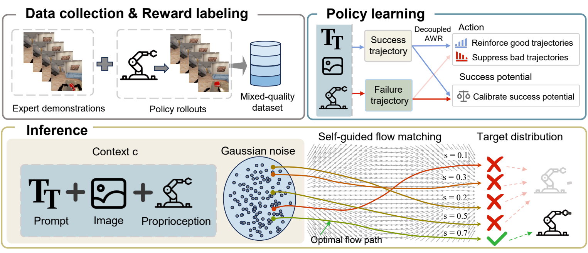

<div align="center">

# ForesightFlow
### Self-Guided Flow Matching for Improving Vision-Language-Action Models

**NeurIPS 2026 · Poster**

[](https://arxiv.org/abs/2606.04968)
[](https://arxiv.org/pdf/2606.04968)
[](https://github.com/sejmoonwei/ForesightFlow)

Yunpeng Mei<sup>1,&#42;</sup>, Jiakai He<sup>1,&#42;</sup>, Hongjie Cao<sup>1,&#42;</sup>, Chenyu Wang<sup>1,&#42;</sup>, Xiaowen Zhu<sup>1</sup>,<br>
Yihan Zhou<sup>2</sup>, Jiamin Wang<sup>1</sup>, Chenbo Xin<sup>1</sup>, Peng Cheng<sup>1</sup>, Yuxuan Yang<sup>1</sup>,<br>
Yijie Wang<sup>1</sup>, Xinhu Zheng<sup>3</sup>, Gao Huang<sup>2</sup>, Jie Chen<sup>1</sup>, Gang Wang<sup>1,†</sup>

<sup>1</sup> Beijing Institute of Technology<br>
<sup>2</sup> Tsinghua University<br>
<sup>3</sup> The Hong Kong University of Science and Technology (Guangzhou)

<sup>&#42;</sup> Equal contribution. &nbsp; <sup>†</sup> Corresponding author.

</div>

## Overview

**ForesightFlow** improves flow-based vision-language-action policies using mixed-quality experience, including successful demonstrations, partial completions, and failures. It jointly generates action chunks and success-potential vectors, allowing the same policy to propose and rank candidate actions without a separate critic.

<p align="center">
  
</p>

## Method

- **Joint action and potential generation.** Each flow endpoint contains an action chunk and its success-potential coordinates, supervised using stage-outcome labels.
- **Decoupled training.** Advantage weights apply to action velocities, while potential velocities are trained uniformly on both successful and failed samples.
- **One-step baseline estimation.** A conditional-flow boundary estimator computes a context-dependent baseline for advantage-weighted training with one stop-gradient forward pass.
- **Self-guided inference.** The policy generates multiple candidates and selects an action chunk using its jointly generated potential score.

## Code release

This release contains the LIBERO implementation.

## LIBERO

Run the following commands from the directory containing `scripts/run.py`.
Training and full evaluation use eight NVIDIA GPUs. Training/policy serving and simulation use separate Python environments.

### Install

```bash
sudo apt-get update
sudo apt-get install -y git build-essential jq iproute2 util-linux libegl1 libgl1 libglib2.0-0

python3 -m pip install --user uv
export PATH="$HOME/.local/bin:$PATH"

bash scripts/install.sh server
bash scripts/install.sh sim

cp configs/paths.example.json configs/paths.local.json
```

Edit `configs/paths.local.json` to set:

- `expert_data`: the stage-labeled expert dataset (`data/expert_stage`).
- `rollout_data`: the stage-labeled failed-rollout dataset (`data/rollouts_stage`).
- `init_checkpoint`: the actor initialization checkpoint's `params/` directory.
- `checkpoint`: the evaluation checkpoint directory containing `params/` and `assets/`.

### Download training data

The [training dataset](https://huggingface.co/datasets/sejmoonwei/ForesightFlow-LIBERO) contains 400 successful expert demonstrations and failed policy rollouts, both with stage annotations. The expert subset is derived from [LIBERO demonstrations](https://github.com/Lifelong-Robot-Learning/LIBERO); it is already converted and labeled for this loader.

While the dataset is private, first log in with an authorized account:

```bash
.venv-server/bin/huggingface-cli login
.venv-server/bin/huggingface-cli download sejmoonwei/ForesightFlow-LIBERO \
  --repo-type dataset --local-dir data
```

The download uses the default data paths in `configs/paths.example.json`. Actor initialization weights and the evaluation checkpoint are provided separately. Each dataset root uses this layout for the four suites (`libero_spatial`, `libero_object`, `libero_goal`, `libero_10`), with task IDs 0–9:

```text
<dataset>/<suite>/<suite>_tN/
  data/chunk-000/episode_XXXXXX.parquet
  rewards/chunk-000/episode_XXXXXX.npy
  meta/episodes.jsonl
  meta/stages.json
  meta/sampling_layout.json
```

Parquet files contain `image`, `wrist_image`, `state` (8 values) and `actions` (7 values). Each reward array contains per-frame stage milestones aligned with its episode. A failed rollout can contain completed stages and positive stage-level labels. Keep the metadata files: they provide stage counts and sampling indices without requiring additional trajectories. The supplied sampling layout uses action horizon 10 and post-success-anchor filtering. Preserve the checkpoint directory structure and use the included normalization statistics.

### Train

```bash
WANDB_MODE=offline .venv-server/bin/python scripts/run.py train \
  --exp-name libero_fresh_seed42 \
  --gpus 0,1,2,3,4,5,6,7
```

Training settings are in [configs/train_args.json](configs/train_args.json).
With the default output directory, the final checkpoint is `outputs/checkpoints/libero_fresh_seed42/10000`.

### Evaluate

Evaluate the checkpoint configured in `configs/paths.local.json` with seed 17:

```bash
.venv-server/bin/python scripts/run.py eval \
  --seed 17 --mode argmax \
  --gpus 0,1,2,3,4,5,6,7 \
  --run-name libero_seed17_argmax

.venv-server/bin/python scripts/run.py eval \
  --seed 17 --mode random \
  --gpus 0,1,2,3,4,5,6,7 \
  --run-name libero_seed17_random
```

Each command evaluates 40 tasks with 20 episodes per task (800 episodes), using five candidates, ten flow steps and five executed actions per replan.

To evaluate a newly trained checkpoint:

```bash
.venv-server/bin/python scripts/run.py eval \
  --checkpoint outputs/checkpoints/libero_fresh_seed42/10000 \
  --seed 17 --mode argmax \
  --run-name libero_trained_seed17_argmax
```

For all four evaluation seeds:

```bash
for seed in 7 17 27 37; do
  for mode in random argmax; do
    .venv-server/bin/python scripts/run.py eval \
      --seed "$seed" --mode "$mode" \
      --run-name "libero_full_seed${seed}_${mode}"
  done
done
```

Results are saved to `outputs/eval_results/<run-name>/ckpt_10000.json` with the default output directory. Use a new run name for each evaluation.

## Citation

If you find this work useful, please cite:

```bibtex
@inproceedings{mei2026foresightflow,
  title     = {ForesightFlow: Self-Guided Flow Matching for Improving Vision-Language-Action Models},
  author    = {Yunpeng Mei and Jiakai He and Hongjie Cao and Chenyu Wang and Xiaowen Zhu and Yihan Zhou and Jiamin Wang and Chenbo Xin and Peng Cheng and Yuxuan Yang and Yijie Wang and Xinhu Zheng and Gao Huang and Jie Chen and Gang Wang},
  booktitle = {Advances in Neural Information Processing Systems},
  year      = {2026},
  url       = {https://openreview.net/forum?id=ZHqszixmfx}
}
```

## License

FPF-owned code is licensed under [Apache-2.0](LICENSE).
Third-party components retain their [original licenses](THIRD_PARTY_NOTICES.md).
Model weights and datasets retain their applicable upstream terms; the code license does not replace them.
