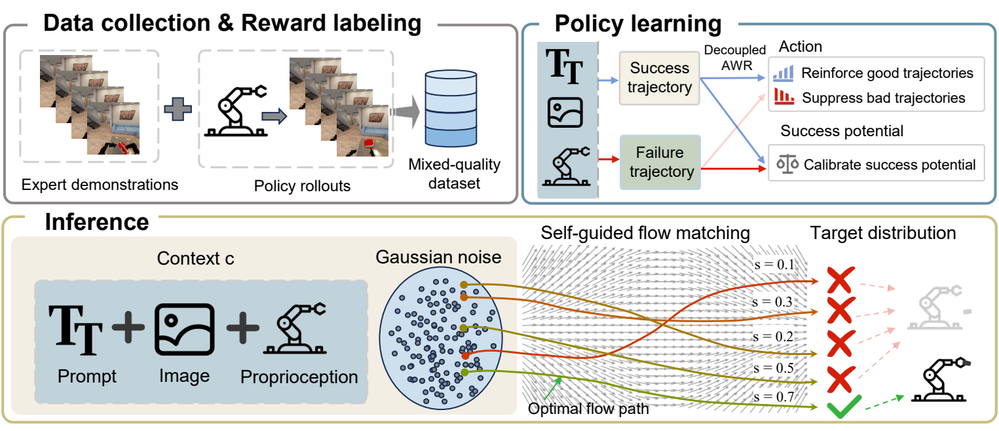

<div align="center">

# ForesightFlow
### Self-Guided Flow Matching for Improving Vision-Language-Action Models

**NeurIPS 2026 · Poster**

[](https://openreview.net/forum?id=ZHqszixmfx)
[](https://openreview.net/pdf?id=ZHqszixmfx)
[](#code-release)

Yunpeng Mei<sup>1,&#42;</sup>, Jiakai He<sup>1,&#42;</sup>, Hongjie Cao<sup>1,&#42;</sup>, Chenyu Wang<sup>1,&#42;</sup>, Xiaowen Zhu<sup>1</sup>,<br>
Yihan Zhou<sup>2</sup>, Jiamin Wang<sup>1</sup>, Chenbo Xin<sup>1</sup>, Peng Cheng<sup>1</sup>, Yuxuan Yang<sup>1</sup>,<br>
Yijie Wang<sup>1</sup>, Xinhu Zheng<sup>3</sup>, Gao Huang<sup>2</sup>, Jie Chen<sup>1</sup>, Gang Wang<sup>1,†</sup>

<sup>1</sup> Beijing Institute of Technology<br>
<sup>2</sup> Tsinghua University<br>
<sup>3</sup> The Hong Kong University of Science and Technology (Guangzhou)

<sup>&#42;</sup> Equal contribution. &nbsp; <sup>†</sup> Corresponding author: [Gang Wang](mailto:gangwang@bit.edu.cn).

</div>

## Overview

**ForesightFlow** improves flow-based vision-language-action policies using mixed-quality experience, including successful demonstrations, partial completions, and failures. It jointly generates action chunks and success-potential vectors, allowing the same policy to propose and rank candidate actions without a separate critic.

<p align="center">
  
</p>

## Method

- **Joint action and potential generation.** Each flow endpoint contains an action chunk and its success-potential coordinates, supervised using stage-outcome labels.
- **Decoupled training.** Advantage weights apply to action velocities, while potential velocities are trained uniformly on both successful and failed samples.
- **One-step baseline estimation.** A conditional-flow boundary estimator computes a context-dependent baseline for advantage-weighted training with one stop-gradient forward pass.
- **Self-guided inference.** The policy generates multiple candidates and selects an action chunk using its jointly generated potential score.

## Code release

This repository is the official project repository for ForesightFlow. The implementation is being prepared for release. Release contents and usage instructions will be documented here when available.

**Current status:** paper and method overview available; implementation not yet released.

## Citation

If you find this work useful, please cite:

```bibtex
@inproceedings{mei2026foresightflow,
  title     = {ForesightFlow: Self-Guided Flow Matching for Improving Vision-Language-Action Models},
  author    = {Yunpeng Mei and Jiakai He and Hongjie Cao and Chenyu Wang and Xiaowen Zhu and Yihan Zhou and Jiamin Wang and Chenbo Xin and Peng Cheng and Yuxuan Yang and Yijie Wang and Xinhu Zheng and Gao Huang and Jie Chen and Gang Wang},
  booktitle = {Advances in Neural Information Processing Systems},
  year      = {2026},
  url       = {https://openreview.net/forum?id=ZHqszixmfx}
}
```
